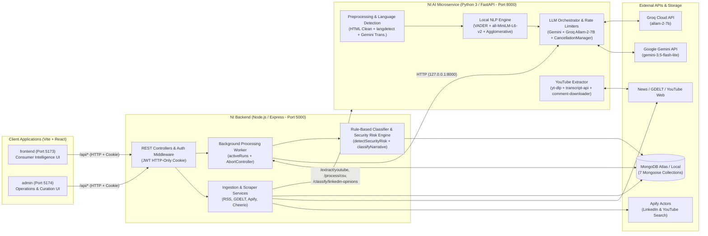
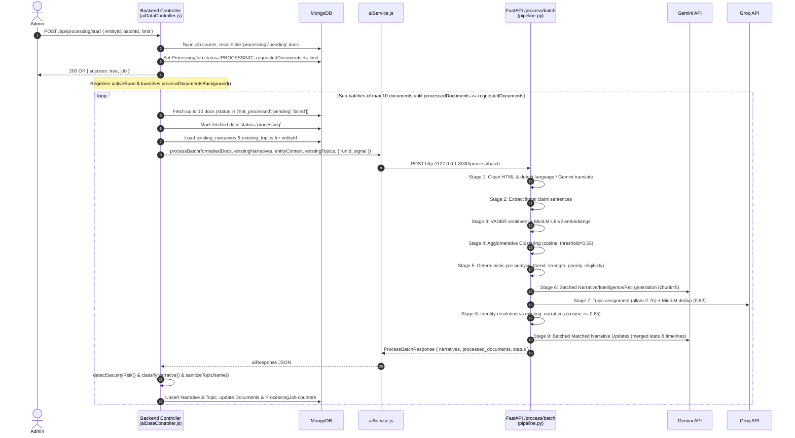
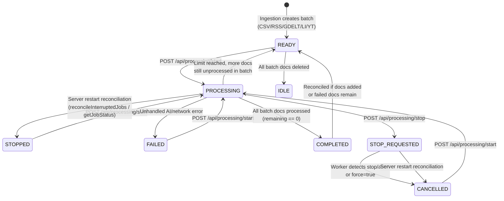
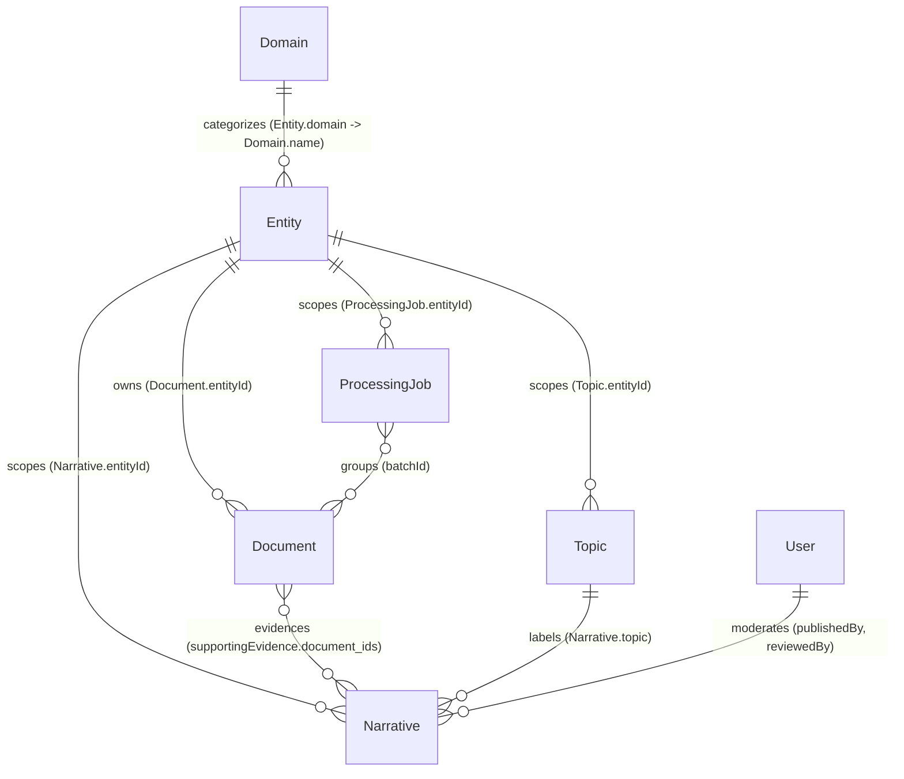

# Narrative Intelligence (`NI`) — Technical Architecture & Developer Documentation

> **Document Scope:** Single source of truth for the `NI` platform, covering the Node.js/Express API & Orchestration Layer (`backend/`), the Python/FastAPI AI & NLP Processing Microservice (`ai/`), the MongoDB persistence schema, and the external integration contracts consumed by `admin/` and `frontend/`.  
> **Target File:** `NI/DOCUMENTATION.md`

---

## Table of Contents

1. [Module Overview & Architectural Scope](#1-module-overview--architectural-scope)
2. [Main Processing Pipeline (End-to-End Execution Flow)](#2-main-processing-pipeline-end-to-end-execution-flow)
3. [Tech Stack & Third-Party Dependencies](#3-tech-stack--third-party-dependencies)
4. [LLM Integration & Resilience (Gemini & Groq AI Services)](#4-llm-integration--resilience-gemini--groq-ai-services)
5. [Data Schemas & Models](#5-data-schemas--models)
6. [Routes, Controllers & Middleware](#6-routes-controllers--middleware)
7. [Detailed Feature Catalog & Implementation Logic](#7-detailed-feature-catalog--implementation-logic)
8. [Development & Continuation Guide](#8-development--continuation-guide)

---

## 1. Module Overview & Architectural Scope

### 1.1 Core Purpose & Responsibility
**Narrative Intelligence (`NI`)** is a multi-tenant, domain-agnostic intelligence ingestion, NLP processing, and narrative tracking platform. Its primary responsibility is to ingest unstructured text from heterogeneous public and offline sources (CSV datasets, Google News RSS, GDELT DOC 2.0, YouTube video transcripts/comments, and LinkedIn posts/comments), deduplicate and normalize them into MongoDB, and process them through a 10-stage hybrid local-NLP + LLM pipeline to produce:
- **Evidence-backed Narratives** with full chain-of-custody traceability (`Narrative -> Claim IDs -> Document IDs -> Sources`).
- **Context-Aware Classification & Prioritization** (`direction`: negative/positive/neutral/mixed; negative `priority`: critical/high/medium/low; positive `positiveSignificance`: significant/notable/general; safety-critical `isSecurityRisk` detection).
- **Canonical Subject Topics** normalized per entity without entity/domain prefix pollution.
- **Temporal Trend Analysis** (`Rising`, `Declining`, `Stable`, `Insufficient Data`) computed via chronological claim velocity and linear regression.
- **Executive Moderation & Publication Controls** governing what narratives become visible to public/consumer users.

### 1.2 High-Level System Architecture



### 1.3 Inter-Module Interface Contract (`frontend/` and `admin/` ↔ `NI`)
Both sibling client applications (`frontend` and `admin`) communicate strictly with the `NI` Node.js backend (`server.js` on port `5000`), never directly with MongoDB or the Python FastAPI service (`port 8000`):

- **Transport & Proxy Configuration:**
  - `frontend/src/services/api.js` and `admin/src/services/api.js` both instantiate Axios with `baseURL: import.meta.env.VITE_API_URL || '/api'` and `withCredentials: true`.
  - In development, `frontend/vite.config.js` (port `5173`) and `admin/vite.config.js` (port `5174`) proxy `/api/*` directly to `http://localhost:5000`.
  - Backend CORS (`backend/server.js`) whitelists `http://localhost:5173`, `http://localhost:5174`, `http://127.0.0.1:5173`, `http://127.0.0.1:5174`, `process.env.FRONTEND_URL`, and `process.env.ADMIN_URL` with `credentials: true`.
- **Authentication Contract:**
  - Authentication relies on an HTTP-only cookie named `jwt` signed with `JWT_SECRET` (`sameSite: 'strict'`, `30d` expiration).
  - Protected routes validate `req.cookies.jwt` via `protect`; admin-only endpoints additionally enforce `req.user.role === 'admin'` via `admin`.
- **Consumer Interface (`frontend`):**
  - Consumes read-oriented endpoints: `GET /api/narratives`, `GET /api/narratives/:id`, `GET /api/sources`, `GET /api/entities`, `GET /api/domains`, `GET /api/topics`, and `/api/auth/*`.
- **Operations Interface (`admin`):**
  - Consumes full CRUD, ingestion, discovery, processing, and moderation endpoints: `/api/documents/*`, `/api/scraper/*`, `/api/processing/*`, `/api/admin/narratives/*`, `/api/admin/dashboard/attention-narratives`, `/api/entities/*`, `/api/domains/*`, and `/api/auth/*`.

---

## 2. Main Processing Pipeline (End-to-End Execution Flow)

The primary Narrative Intelligence pipeline transforms queued `Document` records in MongoDB into persisted `Narrative` and `Topic` records through a coordinated Node.js background loop (`backend/controllers/aiDataController.js -> processDocumentsBackground`) and the Python FastAPI 10-stage pipeline (`ai/app/pipeline/pipeline.py -> process_batch`).



### 2.1 Stage 1: Input Ingestion & Validation
1. **Batch Creation (Pre-Processing):**
   - Documents enter the `documents` collection with `processingStatus: 'not_processed'` (or `'pending'` for official NIT Raipur website records with extracted text).
   - Multi-document ingestion methods (CSV upload, RSS scrape, GDELT scrape, LinkedIn post/discovery, YouTube extraction/discovery) assign a unique `batchId` (e.g., `BATCH_17...`, `BATCH_SCRAPE_...`, `BATCH_GDELT_...`, `BATCH_LI_...`, `BATCH_LI_DISC_...`, `BATCH_YT_...`, `BATCH_YT_DISC_...`) and create a `ProcessingJob` record initialized to `status: 'READY'`.
2. **Job Trigger & Pre-Flight Validation (`startProcessingJob` in `backend/controllers/aiDataController.js`):**
   - Validates `limit > 0`.
   - Resolves target `ProcessingJob` (either matching `batchId` or the most recent job for `entityId` with unprocessed documents).
   - Rejects jobs in `'IDLE'` or already `'PROCESSING'` state (`400 Bad Request`).
   - Reconciles `totalDocuments` and `processedDocuments` against live `Document` counts and resets any orphaned `'processing'`/`'pending'` documents back to `'not_processed'`.
   - Clamps `limitNum` to `unprocessedCount`, generates a unique `runId` (`RUN_<timestamp>_<random>`), instantiates an `AbortController`, sets `job.status = 'PROCESSING'` and `job.requestedDocuments = job.processedDocuments + limitNum`, saves to `activeRuns` (`Map`), and spawns `processDocumentsBackground(job._id, runId)` asynchronously.
3. **Sub-Batch Assembly (`processDocumentsBackground`):**
   - Loops in chunks of `batchSize = 10` (clamped by `requestedDocuments - processedDocuments`).
   - Queries `Document` where `processingStatus` is `in ['not_processed', 'pending', 'failed']` for `job.entityId` (and `job.batchId` if present).
   - Marks selected documents `processingStatus = 'processing'`, `processingStartedAt = new Date()`.
   - Constructs `BatchRequest` JSON containing:
     - `run_id`: `effectiveRunId`
     - `documents`: `RawDocument[]` (`document_id`, `text`, `original_text`, `detected_language`, `translated_text`, `processing_text`, `translation_status`, `source`, `source_type`, `author`, ISO dates).
     - `existing_narratives`: All existing `Narrative` documents for `entityId` (`narrative_id`, `text`, `topic`, `claim_count`, `source_count`, `claim_ids`, `document_ids`, `sources`, `sentiment`, `temporal_information`, `timeline`).
     - `analysis_context`: `EntityContext` from `Entity` lookup (`entity_id`, `entity_name`, `entity_type`, `domain`).
     - `existing_topics`: All `Topic` documents for `entityId` (`topic_id`, `name`).

### 2.2 Stage 2: Pre-Processing & Context Preparation (Python AI Service)
Inside `ai/app/main.py -> process_batch_endpoint`, the FastAPI service registers `run_id` with `cancellation_manager.start_run(run_id)` and calls `process_batch(request)` (`ai/app/pipeline/pipeline.py`).

For each `RawDocument`:
1. **Text Cleaning (`preprocess_document` in `ai/app/pipeline/text_preprocessing.py`):**
   - HTML entity unescaping via `html.unescape()`.
   - Strips HTML tags (`re.sub(r'<[^>]+>', ' ', cleaned)`).
   - Replaces `\xa0` and `\t` with spaces; normalizes line breaks (`\n{3,}` → `\n\n`) and collapses multiple spaces (` {2,}` → `' '`).
   - Tracks metadata (`chars_removed`, `original_length`, `cleaned_length`, `is_empty`).
2. **Language Detection (`detect_language` in `ai/app/pipeline/translation.py`):**
   - Uses deterministic `langdetect` (`DetectorFactory.seed = 0`).
   - Short-circuits empty text (`"unknown", 0.0`) or digits-only text (`"en", 0.90`).
   - **Non-Latin Script Regex Scan (`_SCRIPT_PATTERNS`):** Scans Unicode blocks for Devanagari (`hi`), Telugu (`te`), Tamil (`ta`), Bengali (`bn`), Kannada (`kn`), Malayalam (`ml`), Gujarati (`gu`), Gurmukhi (`pa`), Arabic/Urdu (`ar`), Chinese (`zh-CN`), Japanese (`ja`), and Cyrillic (`ru`). Returns `0.95` confidence if ≥ 3 matches or > 5% of alphabetic chars match.
   - **Short Pure-ASCII Heuristic:** ≤ 4 ASCII words immediately resolve to `("en", 0.99)`.
   - **Fallback `langdetect.detect_langs`:** If pure-ASCII text yields a non-English code with `< 0.70` probability, coerces to `("en", 0.85)` to prevent short slang misclassifications.
3. **Conditional Translation (`process_document_language` in `translation.py`):**
   - English (`"en"`) → `translation_status = "not_required"`, `processing_text = cleaned_text`.
   - Empty / `"unknown"` → `translation_status = "skipped"`.
   - **Translation Cache Hit:** If `raw_doc.translated_text` is non-empty and either `raw_doc.translation_status == "translated"` or `raw_doc.original_text == cleaned_text`, reuses cached translation (`translation_source = "cached"`).
   - **Gemini Chunked Translation:** Otherwise splits text into chunks (`MAX_CHUNK_CHARS = 3000`) via `split_text_into_chunks()` (splitting by paragraphs `\n\n`, then sentence punctuation `[.!?।॥\n]`, then word boundaries) and translates each chunk sequentially using Gemini (`GEMINI_TRANSLATION_MODEL`, default `gemini-3.5-flash-lite`) via `generate_with_retry`.
   - **Failure Isolation:** On non-cancellation exception during translation, sets `translation_status = "failed"`, `processing_text = ""`, `text = ""`, logs `translation_error` in metadata, and allows the remaining batch to continue.

### 2.3 Stage 3: Core Processing Engine & AI Orchestration
1. **Deterministic Claim Extraction (`extract_claims` in `ai/app/pipeline/claim_extraction.py`):**
   - Guardrail: Skips documents where `translation_status == "failed"` or non-English documents without `"translated"` status.
   - Splits `processing_text` via `split_into_sentences()` (protects abbreviations like `B.Tech.`, `M.Tech.`, `Ph.D.`, `Dr.`, `Prof.`, `F. No.`, `e.g.`, `i.e.`, single capital initials, then splits on `(?<=[.!?])\s+(?=[A-Z])` and newlines).
   - Filters each sentence with `is_meaningful_claim()`: rejects questions (`?`), headers (`:`), `< 4` words, greetings (`hi`, `hello`, `thanks`, etc.), web boilerplate (`click here`, `read more`, `privacy policy`, `subscribe to`, etc.), and pure URLs/`@` handles.
   - Assigns `claim_id = CLM_<3-digit-idx>_<6-hex>` carrying `source_metadata`.
2. **Claim Enrichment (`enrich_claims` in `ai/app/pipeline/claim_enrichment.py`):**
   - **Sentiment:** Computes `SentimentIntensityAnalyzer().polarity_scores(text)['compound']` (VADER). Maps `>= 0.05` → `"positive"`, `<= -0.05` → `"negative"`, else `"neutral"`. Stores `sentiment_confidence = round(abs(compound), 4)`.
   - **Embeddings:** Encodes `claim.text` using local HuggingFace `SentenceTransformer` (`EMBEDDING_MODEL`, default `"all-MiniLM-L6-v2"`, `HF_HUB_OFFLINE="1"`).
3. **Semantic Claim Clustering (`group_claims` in `ai/app/pipeline/claim_grouping.py`):**
   - Runs `sklearn.cluster.AgglomerativeClustering(n_clusters=None, metric="cosine", linkage="average", distance_threshold=0.65)` over claim embedding vectors. (Single claim bypasses clustering).
   - Produces `ClaimGroup` objects (`GRP_<label>_<4-hex>`).
4. **Deterministic Group Pre-Analysis (`analyze_claim_group` in `ai/app/pipeline/narrative_analysis.py`):**
   - `analyze_cross_source()`: Deduplicates normalized `.title()` source names.
   - `analyze_narrative_trend()`: Parses claim `published_at`/`collected_at` dates, aggregates daily claim counts & average sentiment into `timeline`, and requires `>= 3` total claims across `>= 2` distinct dates spanning `days_span > 0` to classify trend (`Insufficient Data` otherwise). Fits linear slope via `np.polyfit(x_days, y_counts, 1)` and compares recent half vs early half claim rates:
     - `(normalized_slope > 0.25 and rate_change_ratio > 0.15) or rate_change_ratio > 0.35` → `"Rising"`
     - `(normalized_slope < -0.25 and rate_change_ratio < -0.15) or rate_change_ratio < -0.35` → `"Declining"`
     - Else `"Stable"`
   - `score_narrative()`: Computes evidence strength (`0.0` to `1.0`):
     `final_score = 0.50 * min(log10(claim_count + 1) / 2.0, 1.0) + 0.30 * min(unique_sources / 5.0, 1.0) + 0.20 * abs(avg_sentiment)`
   - `classify_narrative_context()`: Rule-based engine determining `direction`, `priority`, `positive_significance`, `classification_reason`, and `impact_indicators` (see Section 7.15).
   - `evaluate_display_eligibility()`: Returns `("established", True, reason)` if `severity_level` is `"high"`/`"critical"`, `source_count >= 2`, or (`claim_count >= 2` and `strength >= 0.35`); otherwise `("candidate", False, reason)`.
5. **Batched Narrative & Intelligence Synthesis (`generate_narratives_batched` in `ai/app/pipeline/narrative_intelligence.py`):**
   - Chunks `work_items` by `GEMINI_MAX_BATCH_SIZE` (default `5`).
   - Calls `GEMINI_NARRATIVE_MODEL` (default `gemini-3.5-flash-lite`) with `response_mime_type="application/json"` and `response_schema=BatchedNarrativesResponse` (or `GeminiNewNarrativeResult` for size 1).
   - Applies `_clean_recommendation()` to strip vague "monitor evidence / check claims" cop-outs and meteorological metaphors, replacing them with `"Insufficient information for an actionable recommendation."`.
   - Any batch parse/mismatch falls back automatically to per-group `generate_new_narrative()`.
6. **Canonical Topic Assignment (`assign_topic` in `ai/app/pipeline/topic_assignment.py`):**
   - Sanitizes existing topic names (`sanitize_topic_name()` strips entity/domain names and remaps via `CANONICAL_TOPIC_REMAP`).
   - Invokes Groq (`GROQ_TOPIC_MODEL`, default `allam-2-7b`) with `response_format={"type": "json_object"}` and validates against `TopicResult`.
   - Sanitizes output and performs semantic duplicate detection against `working_topics` using `all-MiniLM-L6-v2` cosine similarity (`threshold = 0.82`) before minting `TOPIC_<8-hex>`. Dynamically appends new topics to `working_topics` within the batch.
7. **Historical Identity Resolution & Matched Narrative Updates (`resolve_identity` & `update_matched_narratives_batched`):**
   - Encodes `candidate_narrative.narrative` with `all-MiniLM-L6-v2` and compares cosine similarity against all `existing_narratives` (`threshold = 0.85`).
   - If matched: `_compute_merged_narrative_stats()` merges `claim_ids`, `document_ids`, `sources`, weighted `combined_sentiment`, recalculates `combined_strength`, merges historical `timeline` with new claims for updated trend, incorporates `existing.text` alongside `new_group_claims` and `combined_claim_count` into `classify_narrative_context()`, and passes the resulting `severity_level` (`critical`/`high`/`normal`) into `evaluate_display_eligibility()`. Then calls Gemini (`BatchedMatchedUpdatesResponse` / `GeminiUpdatedNarrativeResult`) in chunks of `5` to regenerate `intelligence` and `recommendation`.

### 2.4 Stage 4: Post-Processing & Output Generation (Node.js Backend)
Upon receiving `aiResponse` in `processDocumentsBackground` (`backend/controllers/aiDataController.js`):
1. **Backend Security Risk & Re-Classification:**
   - Fetches up to 20 referenced source `Document` records by MongoDB `_id` (`supporting_evidence.document_ids`).
   - Runs `detectSecurityRisk(nar, sourceDocuments)` and `classifyNarrative(nar, sourceDocuments, risk)`.
   - Computes `isSecurityRisk = classification.isSecurityRisk || classification.priority === 'critical'`. If `true`, overrides display eligibility to `isEligible = true` (`displayStatus = 'established'`), whereas non-critical high-priority complaints must still satisfy `(sCount >= 2) || (cCount >= 2 && strength >= 0.35)` or AI's `is_eligible`.
   - Sanitizes `topic` with `sanitizeTopicName()` and normalizes trend labels (`increasing` → `Rising`, `decreasing` → `Declining`, `stable` → `Stable`).
2. **Moderation Reset Guardrail:**
   - Checks `hasNewEvidence` (whether any `referencedDocumentIds` are new compared to `existing.supportingEvidence.document_ids`).
   - If `classification.priority === 'critical'` AND (`!existing` OR `existing.priority !== 'critical'` OR `hasNewEvidence`), forces `publicationStatus = 'Pending Review'` and `isPublished = false` so new safety-critical findings cannot auto-publish silently.
3. **Database Persistence:**
   - `Narrative.findOneAndUpdate({ narrativeId: nar.narrative_id }, { $set: updateFields }, { upsert: true, new: true })`.
   - Upserts non-`"Unknown"`/`"General"` topics into `Topic` collection keyed by `{ entityId, name }`.
   - Iterates `aiResponse.processed_documents` to update each `Document` with `detectedLanguage`, `translationStatus`, `processingText`, `translatedText`, and sets `processingStatus` to `'failed'` (if `translation_status === 'failed'`) or `'completed'` (with fallback batch update if `processed_documents` omitted).
   - Increments `ProcessingJob` counters (`processedDocuments`, `failedDocuments`, `newNarrativesAdded`, `existingNarrativesUpdated`, `claimsExtracted`) and saves.
4. **Loop Termination:**
   - Once `job.processedDocuments >= job.requestedDocuments` or `unprocessedDocs.length === 0`, checks remaining unprocessed docs in the batch: sets `job.status` to `'COMPLETED'` if `0` remain, else `'READY'`, and removes `jobId` from `activeRuns`.

### 2.5 Async Workers & State Transitions

#### In-Memory Registries
- **Node.js `activeRuns` (`backend/controllers/aiDataController.js`):** `Map<jobIdString, { runId, jobId, batchId, entityId, abortController, startedAt }>`. Tracks active background loops and holds each run's `AbortController`.
- **Python `cancellation_manager` (`ai/app/pipeline/cancellation.py`):** Thread-safe singleton using `threading.Lock()`, maintaining `_active_runs: Set[str]` and `_cancelled_runs: Set[str]`. Checked between every document, claim stage, rate-limit sleep slice (`0.25s`), and LLM batch chunk.
- **Python `metrics_collector` (`ai/app/pipeline/metrics.py`):** Thread-safe singleton (`_runs` dict) tracking per-stage provider/model call counts, durations, rate-limit wait time, retries, and prompt/completion tokens, printed to stdout at batch completion.

#### `ProcessingJob` State Machine


#### `Document.processingStatus` Transitions
- `'not_processed'` → `'processing'` (picked up by sub-batch worker) → `'completed'` (success) or `'failed'` (AI error or `translation_status === 'failed'`).
- On `STOP_REQUESTED` / `CANCELLED` / server restart reconciliation: any `'processing'` or `'pending'` documents are reverted cleanly back to `'not_processed'` (`processingStartedAt: null`).

### 2.6 Pipeline Failure Modes & Recovery Points

| Pipeline Stage | Failure Mode | Mitigation / Retry Logic | Recovery & State Rollback |
| :--- | :--- | :--- | :--- |
| **CSV / Processing Startup** | Python AI service offline (`ECONNREFUSED`, `ETIMEDOUT`) | Pre-flight `aiService.checkHealth()` (`GET /health`, 3.5s timeout). | Returns HTTP `503 AI_SERVICE_UNAVAILABLE` immediately; no partial DB state created. |
| **Language Translation** | Non-English Gemini failure / malformed response | `generate_with_retry` (max 3 retries, exponential backoff + `Retry-After`). | Isolated to that document: `translation_status='failed'`, `processing_text=''`. Marked `'failed'` in MongoDB; batch proceeds for remaining docs. |
| **Batched Narrative Gen/Update** | JSON schema validation failure, missing `group_id` / `narrative_id`, or batch error | Retries handled per request inside `generate_with_retry`. | Automatic fallback: loops over unmapped/failed items and runs individual `generate_new_narrative()` / `update_matched_narrative()`. |
| **Groq Topic Assignment** | Groq API outage, quota exhaustion, invalid JSON | `groq_chat_completion_with_retry` (max 3 retries). | Graceful fallback to `proposed_name = "General"`, `is_new = True`; batch completes without crash. |
| **LinkedIn Opinion Classifier** | Groq error or unparseable JSON | 2 retries (`max_retries=2`), fuzzy string matching on partial classification text. | Falls back to `classification = "Uncertain"`, `requires_manual_inspection = True` for admin triage. |
| **Admin Cancellation (`Stop`)** | User stops long-running job | Fires `aiService.cancelBatch(runId)` + `abortController.abort()` + DB `stopRequested=true`. | Python raises `BatchCancelledException` and returns `status: "cancelled"`. Backend reverts in-flight `'processing'`/`'pending'` docs to `'not_processed'` and sets job `'CANCELLED'`. |
| **Node.js Crash / Restart** | Server dies mid-`PROCESSING` leaving stale DB locks | `reconcileInterruptedJobs()` on DB connect + live check in `getJobStatus()` / `getProcessingStatus()`. | Jobs missing from `activeRuns` are marked `'STOPPED'` (or `'CANCELLED'` if `stopRequested`), and stuck docs are reset to `'not_processed'`. |
| **Document Deletion Drift** | Admin deletes documents after batch creation | `deleteDocument()`, `bulkDeleteDocuments()`, startup `reconcileJobDocumentCounts()`. | Recomputes `totalDocuments`, `processedDocuments`, `failedDocuments`; marks empty jobs `'IDLE'` or fully processed remaining sets `'COMPLETED'`. |

---

## 3. Tech Stack & Third-Party Dependencies

### 3.1 Runtime Environments
- **Backend API & Worker:** Node.js (ESM `"type": "module"`, tested on Node v22+), Express `^5.2.1`.
- **AI Processing Microservice:** Python 3.x (documented Python 3.11 in `ai/README.md`), FastAPI `0.110.0`, Uvicorn `0.27.1`.
- **Database:** MongoDB (Atlas cluster or local instance) via Mongoose `^9.9.3`.
- **Monorepo Runner:** `concurrently ^9.0.1` (root `package.json`).

### 3.2 Node.js Backend Dependencies (`backend/package.json`)

| Package | Version Spec | Used In | Role in `NI` |
| :--- | :--- | :--- | :--- |
| `express` | `^5.2.1` | `backend/server.js`, `backend/routes/*.js` | HTTP server, Express 5 router (`{*path}` wildcard CORS), JSON body parsing. |
| `mongoose` | `^9.9.3` | `backend/config/db.js`, `backend/models/*.js` | MongoDB ODM, schemas, validation, partial/compound indexes, aggregations. |
| `axios` | `^1.20.0` | `backend/services/*.js` | HTTP client for AI microservice, Apify REST actors, GDELT DOC API, and live article HTML extraction. |
| `cheerio` | `^1.2.0` | `backend/services/articleExtractor.js`, `scraperService.js` | Fast server-side DOM/HTML parsing for news article title, JSON-LD, author, date, and body extraction. |
| `rss-parser` | `^3.13.0` | `backend/services/scraperService.js` | Parses Google News RSS XML feeds into structured item lists. |
| `google-news-url-decoder` | `^1.2.2` | `backend/services/scraperService.js` | Decodes obfuscated `news.google.com/rss/articles/...` links into genuine publisher URLs. |
| `jsonwebtoken` | `^9.0.3` | `backend/controllers/authController.js`, `middleware/authMiddleware.js` | Signs and verifies 30-day JWT auth tokens stored in HTTP-only cookies. |
| `bcrypt` | `^6.0.0` | `backend/models/User.js` | Password salting/hashing (`pre('save')`) and login verification (`matchPassword`). |
| `cookie-parser` | `^1.4.7` | `backend/server.js`, `backend/middleware/authMiddleware.js` | Extracts `req.cookies.jwt` for authentication middleware. |
| `cors` | `^2.8.6` | `backend/server.js` | Cross-origin resource sharing enforcement with `credentials: true` and origin whitelist. |
| `dotenv` | `^17.4.2` | `backend/server.js`, `seed_data.js`, `migrate_nit.js` | Loads environment configuration from `backend/.env`. |
| `form-data` | `^4.0.6` | `backend/services/aiService.js` | Streams multipart CSV buffers from Express to FastAPI `POST /process/csv`. |
| `multer` | `^2.4.0` | `backend/routes/documentRoutes.js` | In-memory file upload middleware (`multer.memoryStorage()`) for CSV uploads. |
| `uuid` | `^14.0.2` | `backend/controllers/entityController.js`, `migrate_nit.js` | Generates unique `ENT_<8-hex>` and `TOP_<8-hex>` identifiers. |
| `nodemon` (dev) | `^3.1.14` | `backend/package.json` | Hot-reload development server for backend (`npm run dev`). |

### 3.3 Python AI Service Dependencies (`ai/requirements.txt`)

| Package | Version Spec | Used In | Role in `NI` |
| :--- | :--- | :--- | :--- |
| `fastapi` | `0.110.0` | `ai/app/main.py` | ASGI web framework, OpenAPI docs, Pydantic request/response validation. |
| `uvicorn` | `0.27.1` | Startup CLI (`app.main:app`) | ASGI server hosting FastAPI on port `8000`. |
| `pydantic` | `>=2.8.0,<3` | `ai/app/pipeline/schemas.py`, `narrative_intelligence.py`, `topic_assignment.py` | Data validation, `model_validate_json()`, and Gemini `response_schema` contracts. |
| `google-genai` | *(unpinned)* | `ai/app/pipeline/gemini_utils.py`, `narrative_intelligence.py`, `translation.py` | Official Google GenAI Python SDK for Gemini LLM calls (`client.models.generate_content`). |
| `groq` | `>=1.7.0` | `ai/app/pipeline/groq_utils.py`, `topic_assignment.py`, `linkedin_classifier.py` | Official Groq SDK for fast SLM inference (`allam-2-7b`). |
| `sentence-transformers` | `2.5.1` | `ai/app/pipeline/claim_enrichment.py`, `topic_assignment.py`, `narrative_intelligence.py` | Generates 384-d dense embeddings using `all-MiniLM-L6-v2` (offline mode `HF_HUB_OFFLINE=1`). |
| `torch` | `2.2.1` | Transitive runtime for `sentence-transformers` / `transformers` | Deep learning tensor execution backend. |
| `transformers` | `4.38.2` | Transitive model loader for `sentence-transformers` | HuggingFace transformer architecture support. |
| `scikit-learn` | `1.4.1.post1` | `ai/app/pipeline/claim_grouping.py`, `topic_assignment.py`, `narrative_intelligence.py` | `AgglomerativeClustering` (claim clustering) & `cosine_similarity` (topic & narrative identity). |
| `numpy` | `1.26.4` | `ai/app/pipeline/claim_grouping.py`, `narrative_analysis.py` | Embedding matrix construction and linear regression (`np.polyfit`) for temporal trend slope. |
| `vaderSentiment` | `3.3.2` | `ai/app/pipeline/claim_enrichment.py` | Local rule-based lexicon sentiment analyzer (`compound` score in `[-1, 1]`). |
| `langdetect` | `1.0.9` | `ai/app/pipeline/translation.py` | Seeded (`DetectorFactory.seed = 0`) probabilistic language identification. |
| `youtube-transcript-api` | `>=1.2,<2` | `ai/app/pipeline/youtube_extractor.py` | Retrieves manual or auto-generated YouTube captions without YouTube Data API keys. |
| `yt-dlp` | `>=2024.3.10,<2027` | `ai/app/pipeline/youtube_extractor.py` | Extracts YouTube metadata (title, channel/uploader, `upload_date`, duration) without downloading media. |
| `youtube-comment-downloader` | `>=0.1.84` | `ai/app/pipeline/youtube_extractor.py` | Scrapes YouTube comment threads, author handles, timestamps, and vote counts; checks consent & playability. |
| `python-multipart` | *(unpinned)* | `ai/app/main.py` | Required by FastAPI `UploadFile` / `File(...)` for `/process/csv`. |
| `python-dotenv` | `1.0.1` | `ai/app/pipeline/*.py` | Loads environment configuration from `ai/.env`. |
| `pytest` | `8.0.2` | `ai/requirements.txt` | Python test runner. |

### 3.4 External APIs & 3rd-Party Services

| Service / Actor | Endpoint / Identifier | Used In | Role |
| :--- | :--- | :--- | :--- |
| **Google Gemini API** | Model `gemini-3.5-flash-lite` | `narrative_intelligence.py`, `translation.py` | Batched narrative synthesis, matched narrative updates, and non-English chunk translation. |
| **Groq Cloud API** | Model `allam-2-7b` (`GROQ_TOPIC_MODEL`) | `topic_assignment.py`, `linkedin_classifier.py` | Canonical topic naming and LinkedIn post opinion vs news/irrelevant classification. |
| **Apify Actor: LinkedIn Post** | `data_minds~linkedin-post-scraper` (`/run-sync-get-dataset-items`) | `backend/services/linkedinService.js` | Deep-scrapes a specific LinkedIn post URL and up to `100` comments + reply threads (`APIFY_API_TOKEN`). |
| **Apify Actor: LinkedIn Search** | `coregent~linkedin-posts-search-scraper` | `backend/services/linkedinDiscoveryService.js` | Searches public LinkedIn posts across organisation name + aliases (`useApifyProxy: true`). |
| **Apify Actor: YouTube Search** | `eiv~youtube-search-scraper` | `backend/services/youtubeDiscoveryService.js` | Executes dynamic search queries returning YouTube video URLs, metadata, channel stats, and durations. |
| **Google News RSS** | `https://news.google.com/rss/search` (`hl=en-IN&gl=IN&ceid=IN:en`) | `backend/services/scraperService.js` | Discovers real-time and bounded historical news articles by query & timeframe. |
| **GDELT Project DOC 2.0** | `https://api.gdeltproject.org/api/v2/doc/doc` | `backend/services/gdeltService.js` | Queries historical global news (`mode=artlist`, `format=json`, `sort=datedesc`). |

---

## 4. LLM Integration & Resilience (Gemini & Groq AI Services)

`NI` isolates provider state into two dedicated modules so rate limits and failures in one provider never cascade into the other:
- **Gemini Client & Limiter:** `ai/app/pipeline/gemini_utils.py`
- **Groq Client & Limiter:** `ai/app/pipeline/groq_utils.py`

### 4.1 Exact Model Specifications & Usage Matrix

| Provider | Model Identifier | Env Override | Temperature | Output Enforcement | Where Called |
| :--- | :--- | :--- | :--- | :--- | :--- |
| **Google Gemini** | `gemini-3.5-flash-lite` | `GEMINI_NARRATIVE_MODEL` | Default (`GenerateContentConfig` default) | `response_mime_type="application/json"` + Pydantic `response_schema`, `AutomaticFunctionCallingConfig(disable=True)` | `narrative_intelligence.py` (`generate_new_narrative`, `generate_narratives_batched`, `update_matched_narrative`, `update_matched_narratives_batched`) |
| **Google Gemini** | `gemini-3.5-flash-lite` | `GEMINI_TRANSLATION_MODEL` | `0.1` | Plain text (code-fence stripped) + `AutomaticFunctionCallingConfig(disable=True)` | `translation.py` (`_translate_chunk_with_gemini`) |
| **Groq Cloud** | `allam-2-7b` | `GROQ_TOPIC_MODEL` | `0.1` | `response_format={"type": "json_object"}` + `TopicResult.model_validate_json()` | `topic_assignment.py` (`assign_topic`) |
| **Groq Cloud** | `allam-2-7b` | `GROQ_TOPIC_MODEL` | `0.1` | `response_format={"type": "json_object"}` + `json.loads()` + schema normalization | `linkedin_classifier.py` (`classify_single_post`) |

*(Note: Severity/priority levels are **never** delegated to an LLM; they are computed deterministically via rule-based logic in `narrative_analysis.py` and `aiDataController.js`.)*

### 4.2 Prompt & Output Orchestration

1. **System Instructions & Grounding Rules:**
   - **Narrative Synthesis (`narrative_intelligence.py`):** Instructs Gemini to act as an intelligence analyst scoped to `{entity_name} ({entity_type})` in `{domain}`. Strictly forbids inventing facts, repeating the narrative as the recommendation, outputting generic monitoring cop-outs (`"monitor evidence"`, `"verify claims"`), or using meteorological filler (`"storm of complaints"`, `"weather the storm"`, `"umbrella"`). When evidence is sparse, instructs exact literal string `"Insufficient information for an actionable recommendation."`.
   - **Batched Group Mapping:** Prepends `--- GROUP ID: GRP_xxx ---` (or `--- NARRATIVE ID: NAR_xxx ---` for updates) and enforces exact 1-to-1 ID echo in `results[]` so groups never merge erroneously inside the LLM context window.
   - **Translation (`translation.py`):** Instructs faithful, literal English translation preserving proper nouns, dates, percentages, currency, URLs, and sentiment without summarizing or preambles.
   - **Topic Assignment (`topic_assignment.py`):** System prompt (`"You are an expert taxonomy classification system. Output valid JSON strictly. Never include entity or domain names in topic names."`) enforces generic 2–5 word reusable categories.
   - **LinkedIn Opinion Classification (`linkedin_classifier.py`):** System prompt categorizes posts into 4 discrete labels (`"Relevant Opinion"`, `"News / Announcement"`, `"Irrelevant"`, `"Uncertain"`) and 6 `opinion_type` enums, explicitly preserving user questions/inquiries about the organisation as `"Relevant Opinion"`.
2. **Context Window Management:**
   - **Translation Chunking (`split_text_into_chunks`):** Caps individual translation prompts at `MAX_CHUNK_CHARS = 3000` characters, splitting gracefully on paragraphs, punctuation (`.!?।॥\n`), or word spaces, then reassembling chunks in exact order.
   - **LLM Batching (`GEMINI_MAX_BATCH_SIZE`):** Defaults to `5` claim groups or matched narratives per Gemini call, bounded upstream by Node.js sub-batches of `10` documents (`batchSize = 10`).
3. **Structured Output Validation & Sanitization:**
   - Gemini utilizes native JSON Schema enforcement (`response_schema=BatchedNarrativesResponse`, etc.) parsed immediately via Pydantic `.model_validate_json(response.text)`.
   - Groq strips accidental Markdown code fences (` ```json ` / ` ``` `) prior to `TopicResult.model_validate_json()` or `json.loads()`.
   - `_clean_recommendation()` runs post-generation regex/phrase checks on recommendations (< 25 words containing monitoring cop-outs or weather metaphors) and standardizes invalid responses.

### 4.3 Failure, Rate Limit & Exception Handling

1. **Thread-Safe Sliding-Window Rate Limiters:**
   - **Gemini (`wait_for_rate_limit` in `gemini_utils.py`):** Uses `collections.deque` (`_gemini_request_times`) protected by `threading.Lock()`. Defaults to `GEMINI_MAX_RPM = 15` over `GEMINI_RATE_WINDOW = 60` seconds.
   - **Groq (`wait_for_groq_rate_limit` in `groq_utils.py`):** Isolated `_groq_request_times` deque defaulting to `GROQ_MAX_RPM = 30` over `GROQ_RATE_WINDOW = 60` seconds.
   - **Cancellable Sleep Loops:** Both limiters and retry backoff handlers sleep in `0.25s` increments, checking `cancellation_manager.check_cancelled(run_id)` on each slice so user stop requests interrupt waits within ≤ 250ms.
2. **Error Classification & Exponential Backoff (`generate_with_retry` / `groq_chat_completion_with_retry`):**
   - **Fast-Fail (Non-Retryable):** HTTP `400`, `401`, `403`, `404`, or errors matching `INVALID_ARGUMENT`, `PERMISSION_DENIED`, `UNAUTHENTICATED`, `API_KEY_INVALID`, `invalid_request_error`, `model_not_found`, `model_decommissioned` immediately record failure metrics and `raise` without retrying.
   - **Retryable:** HTTP `429` (`RESOURCE_EXHAUSTED` / `rate_limit_exceeded`), HTTP `500/502/503/504` (`UNAVAILABLE` / `INTERNAL` / `BAD_GATEWAY`), and network timeouts (`timeout`, `connection error`, `remotedisconnected`) retry up to `GEMINI_MAX_RETRIES=3` / `GROQ_MAX_RETRIES=3`.
   - **Backoff Formula:**
     1. Checks HTTP `Retry-After` header or regex pattern in error text (`_extract_retry_after`); if found (`0.5–120s`), waits `min(60.0, retry_after + uniform(0.1, 0.5))`.
     2. Otherwise, Gemini `429`: `min(30.0, 4.0 * (2 ** attempt) + uniform(0.5, 1.5))`; Gemini 5xx/Timeout: `min(15.0, 1.5 * (2 ** attempt) + uniform(0.2, 0.8))`.
     3. Groq `429`: `min(15.0, 2.0 * (2 ** attempt) + uniform(0.2, 0.8))`; Groq 5xx/Timeout: `min(10.0, 1.0 * (2 ** attempt) + uniform(0.1, 0.5))`.
   - **Secret Redaction:** `_sanitize_error()` masks Google API keys (`AIza...`), Groq keys (`gsk_...`), and `Bearer ...` tokens before console/metadata logging.
3. **Graceful Degradation & Implemented Scope Boundaries:**
   - **Batch-to-Single Fallback:** If a Gemini batch call fails or drops a `group_id`/`narrative_id`, the loop invokes `generate_new_narrative()` / `update_matched_narrative()` individually for affected items.
   - **Default State Recovery:** Groq topic failures recover cleanly to `"General"`; LinkedIn classifier exceptions or invalid labels recover to `"Uncertain"` with `requires_manual_inspection=True` (plus fuzzy string matching on malformed classification strings).
   - **Current Scope Limits:** Secondary model swapping (e.g. falling back from `gemini-3.5-flash-lite` to another Gemini model or from Groq to Gemini), provider-level circuit breakers, response caching for LLM synthesis, and automatic JSON re-prompting repair loops are **not implemented**; Gemini relies on `response_schema` strict typing and batch-to-individual fallback.

---

## 5. Data Schemas & Models

### 5.1 MongoDB / Mongoose Entity-Relationship Diagram



### 5.2 Mongoose Schemas (`backend/models/`)

#### 1. `User` (`backend/models/User.js`)
| Field | Type | Constraints / Default | Notes |
| :--- | :--- | :--- | :--- |
| `_id` | `ObjectId` | Auto PK | MongoDB ObjectId |
| `name` | `String` | `required: true` | Display name |
| `email` | `String` | `required: true, unique: true` | Login credential (unique index) |
| `password` | `String` | `required: true` | Bcrypt-hashed via `pre('save')` hook (`genSalt(10)`) |
| `role` | `String` | `enum: ['user', 'admin'], default: 'user'` | RBAC role (`registerUser` forces `'user'`) |
| `createdAt`, `updatedAt` | `Date` | Auto (`timestamps: true`) | — |
- **Methods:** `matchPassword(enteredPassword)` via `bcrypt.compare`.

#### 2. `Domain` (`backend/models/Domain.js`)
| Field | Type | Constraints / Default | Notes |
| :--- | :--- | :--- | :--- |
| `_id` | `ObjectId` | Auto PK | — |
| `name` | `String` | `required: true, unique: true, trim: true` | e.g., `"Education"`, `"Corporate & Workplace"` |
| `description` | `String` | `default: ''` | Optional domain summary |
| `createdAt`, `updatedAt` | `Date` | Auto (`timestamps: true`) | — |

#### 3. `Entity` (`backend/models/Entity.js`)
| Field | Type | Constraints / Default | Notes |
| :--- | :--- | :--- | :--- |
| `_id` | `ObjectId` | Auto PK | — |
| `entityId` | `String` | `required: true, unique: true` | Format: `ENT_<8-hex>` (or legacy slug) |
| `name` | `String` | `required: true` | Target subject name (e.g., `"NIT Raipur"`) |
| `entityType` | `String` | `required: true` | e.g., `"Institution"`, `"Company"`, `"Product"` |
| `domain` | `String` | `required: true` | Logical FK to `Domain.name` |
| `description` | `String` | `default: ''` | Entity context summary |
| `createdAt`, `updatedAt` | `Date` | Auto (`timestamps: true`) | — |

#### 4. `Document` (`backend/models/Document.js`)
| Field | Type | Constraints / Default | Notes |
| :--- | :--- | :--- | :--- |
| `_id` | `ObjectId` | Auto PK | Passed as `document_id` string to Python AI service |
| `entityId` | `String` | `required: true, index: true` | Tenant/Entity scope |
| `title` | `String` | `default: ''` | Headline or post/comment label |
| `rawText` | `String` | `required: true` | Original ingested text |
| `batchId` | `String` | `default: ''` | Ingestion batch identifier |
| `source` | `String` | `required: true` | Publisher/Platform (`YouTube`, `LinkedIn`, `Google Reviews`, etc.) |
| `sourceType` | `String` | `default: 'Unknown'` | e.g., `News`, `LinkedIn Post`, `YouTube Video`, `social_media` |
| `author` | `String` | `default: 'Unknown'` | Author / Channel name |
| `url` | `String` | `default: ''` | Resolved source URL |
| `canonicalUrl` | `String` | `default: ''` | Normalized URL used for deduplication (`#comment_<id>` for comments) |
| `publicationDate` | `Date` | `default: null` | Genuine publication date (`null` if unknown) |
| `collectedDate` | `Date` | `default: Date.now` | Ingestion timestamp |
| `processingStatus` | `String` | `enum: ['pending', 'processing', 'completed', 'failed', 'not_processed'], default: 'not_processed'` | AI pipeline state |
| `processingStartedAt`, `processingCompletedAt` | `Date` | `default: null` | Lifecycle timestamps |
| `processingError` | `String` | `default: ''` | Last pipeline/translation failure reason |
| `detectedLanguage` | `String` | `default: 'en'` | ISO code detected in AI Stage 2 |
| `translatedText` | `String` | `default: ''` | Cached Gemini English translation |
| `processingText` | `String` | `default: ''` | Exact English text sent to claim extraction |
| `translationStatus` | `String` | `enum: ['not_required', 'translated', 'failed', 'skipped', ''], default: 'not_required'` | Translation workflow status |
| `contentHash` | `String` | `default: ''` | SHA-256 hash of content snippet |
| `metadata` | `Mixed` | `default: {}` | Provenance, likes/views/comments counts, videoId, opinion classification |
| `extractionStatus` | `String` | `enum: ['success', 'partial', 'failed', 'metadata_only', ''], default: ''` | Scraping/extraction completeness |
- **Indexes:**
  - `entityId: 1`

#### 5. `Topic` (`backend/models/Topic.js`)
| Field | Type | Constraints / Default | Notes |
| :--- | :--- | :--- | :--- |
| `_id` | `ObjectId` | Auto PK | — |
| `topicId` | `String` | `required: true, unique: true` | Format `TOPIC_<8-hex>` or `TOP_<8-hex>` |
| `entityId` | `String` | `required: true, index: true` | Tenant/Entity scope |
| `name` | `String` | `required: true` | Sanitized canonical subject category |
| `description` | `String` | `default: ''` | Optional topic note |
- **Indexes:** Unique compound index `{ entityId: 1, name: 1 }` (`unique: true`).

#### 6. `Narrative` (`backend/models/Narrative.js`)
| Field | Type | Constraints / Default | Notes |
| :--- | :--- | :--- | :--- |
| `narrativeId` | `String` | `required: true, unique: true` | Format `NAR_<8-hex>` |
| `entityId` | `String` | `required: true, index: true` | Tenant/Entity scope |
| `topic` | `String` | `default: 'Unknown'` | Sanitized topic name |
| `description` | `String` | `required: true` | Synthesized narrative statement |
| `intelligence`, `recommendation` | `String` | `default: ''` | AI brief & actionable operational steps |
| `trend` | `String` | `enum: ['Rising', 'Declining', 'Stable', 'Insufficient Data'], default: 'Insufficient Data', index: true` | Regression-based recurrence trend |
| `displayStatus` | `String` | `enum: ['established', 'candidate'], default: 'established', index: true` | Controls main dashboard vs candidate tab |
| `isEligibleForDisplay` | `Boolean` | `default: true, index: true` | Eligibility flag |
| `eligibilityReason` | `String` | `default: ''` | Rule rationale |
| `publicationStatus` | `String` | `enum: ['Pending Review', 'Published', 'Held', 'Rejected'], default: 'Pending Review', index: true` | Moderation workflow |
| `isPublished` | `Boolean` | `default: false, index: true` | Public consumer visibility |
| `publishedAt`, `reviewedAt` | `Date` | `default: null` | Moderation audit timestamps |
| `publishedBy`, `reviewedBy` | `ObjectId (User)` | `default: null` | Moderator user reference |
| `severityLevel` | `String` | `enum: ['normal', 'high', 'critical'], default: 'normal', index: true` | Legacy severity indicator |
| `severityReason` | `String` | `default: ''` | Legacy severity rationale |
| `isSecurityRisk` | `Boolean` | `default: false, index: true` | Safety/self-harm/violence alert flag |
| `securityRiskCategory` | `String` | `default: ''` | e.g., `'self_harm'`, `'violence_threat'`, `'public_safety'` |
| `direction` | `String` | `enum: ['positive', 'negative', 'neutral', 'mixed'], default: 'neutral', index: true` | Polarity classification |
| `priority` | `String` | `enum: ['critical', 'high', 'medium', 'low', 'none'], default: 'none', index: true` | Negative criticality tier |
| `positiveSignificance` | `String` | `enum: ['significant', 'notable', 'general', 'none'], default: 'none', index: true` | Positive highlight tier |
| `classificationReason` | `String` | `default: ''` | Classification rationale |
| `impactIndicators` | `[String]` | `default: []` | e.g., `placement_impact`, `infrastructure`, `safety_critical`, `campus_wide` |
| `supportingEvidence` | `Mixed` | `default: {}` | `{ claim_ids: String[], document_ids: String[], sources: String[] }` |
| `analysis` | `Mixed` | `default: {}` | `{ claim_count, source_count, sentiment, temporal_information, recurrence, trend, timeline, strength, display_status, is_eligible, eligibility_reason, direction, priority, positive_significance, classification_reason, impact_indicators }` |
| `lastObservedAt` | `Date` | `default: Date.now` | Timestamp of latest contributing batch |
- **Indexes:** `{ entityId: 1, direction: 1, priority: 1 }`, `{ entityId: 1, isEligibleForDisplay: 1 }`.

#### 7. `ProcessingJob` (`backend/models/ProcessingJob.js`)
| Field | Type | Constraints / Default | Notes |
| :--- | :--- | :--- | :--- |
| `batchId` | `String` | Optional | Linked `Document.batchId` |
| `runId` | `String` | `default: null` | Current active run UUID (`RUN_...`) |
| `entityId` | `String` | `required: true, index: true` | Target entity |
| `status` | `String` | `enum: ['READY', 'PROCESSING', 'STOP_REQUESTED', 'CANCELLED', 'STOPPED', 'COMPLETED', 'FAILED', 'IDLE'], default: 'READY'` | State machine status |
| `totalDocuments`, `processedDocuments`, `requestedDocuments`, `currentRunLimit`, `failedDocuments` | `Number` | `default: 0` | Execution counters & run target cap |
| `newNarrativesAdded`, `existingNarrativesUpdated`, `claimsExtracted` | `Number` | `default: 0` | Cumulative output counters |
| `error`, `cancellationReason` | `String` | `default: null` | Diagnostics |
| `stopRequested` | `Boolean` | `default: false` | Cooperative cancellation flag |
| `startedAt`, `completedAt`, `cancelledAt` | `Date` | `default: null` | Lifecycle timestamps |

### 5.3 Python AI Pipeline Pydantic Schemas (`ai/app/pipeline/schemas.py` & Internal Models)
- **Document DTOs:** `RawDocument` (accepts both snake_case and camelCase aliases via `populate_by_name=True`), `PreprocessedDocument`.
- **Claim DTOs:** `Claim`, `EnrichedClaim` (`sentiment`, `sentiment_confidence`, `embedding: List[float]`), `ClaimGroup`.
- **Narrative DTOs:** `ExistingNarrative`, `Narrative`, `NarrativeEvidence`, `NarrativeAnalysis`, `FinalNarrative`, `ExistingTopic`, `EntityContext`.
- **Endpoint DTOs:** `ProcessDocumentResponse`, `BatchRequest`, `ProcessBatchResponse`, `CancelBatchRequest`, `ProcessCSVResponse`, `YouTubeExtractRequest`, `YouTubeExtractResponse`, `LinkedInPostToClassify`, `LinkedInClassifyRequest`, `LinkedInPostClassification`, `LinkedInClassifyResponse`.
- **Structured LLM Response Schemas:**
  - `narrative_intelligence.py`: `GeminiNewNarrativeResult`, `GeminiUpdatedNarrativeResult`, `BatchedGroupNarrativeItem`, `BatchedNarrativesResponse`, `BatchedMatchedUpdateItem`, `BatchedMatchedUpdatesResponse`.
  - `topic_assignment.py`: `TopicResult` (`topic_name: str`, `is_new_topic: bool`).

---

## 6. Routes, Controllers & Middleware

### 6.1 Express Middleware Stack (`backend/server.js` & `middleware/authMiddleware.js`)
1. `cors(corsOptions)` + `app.options('{*path}', cors(corsOptions))`: Credentials enabled; restricts browser `Origin` header against `allowedOrigins` while allowing empty-origin server/CLI calls.
2. `express.json()`: Parses JSON request bodies.
3. `cookieParser()`: Populates `req.cookies` for `protect`.
4. `protect`: Extracts `req.cookies.jwt`, verifies HMAC signature with `process.env.JWT_SECRET`, loads `User` (excluding `-password`), or clears cookie and returns `401`.
5. `optionalProtect`: Non-blocking variant of `protect`; populates `req.user` when a valid `jwt` cookie is present, or sets `req.user = null` and continues (`next()`).
6. `admin`: Verifies `req.user && req.user.role === 'admin'`, otherwise returns `403`.
7. `multer({ storage: multer.memoryStorage() }).single('file')`: Buffers uploaded CSV files on `/api/documents/upload`.

### 6.2 Express Backend Route Reference (`backend/routes/`)

#### Health & Auth (`/api/auth`)
| Method & URI | Handler | Auth | Request Input | Success / Error Response |
| :--- | :--- | :--- | :--- | :--- |
| `GET /` | `server.js` | Public | None | `200` `"API is running..."` |
| `POST /api/auth/register` | `authController.registerUser` | Public | Body: `{ name, email, password }` | `201` `{ _id, name, email, role:'user' }` + sets `jwt` cookie / `400` exists |
| `POST /api/auth/login` | `authController.loginUser` | Public | Body: `{ email, password }` | `200` `{ _id, name, email, role }` + sets `jwt` cookie / `401` invalid |
| `POST /api/auth/logout` | `authController.logoutUser` | Public | None | `200` `{ message }` (expires `jwt` cookie) |
| `GET /api/auth/me`<br/>`GET /api/auth/profile` | `authController.getUserProfile` | `protect` | Cookie `jwt` | `200` `{ _id, name, email, role }` / `404` |

#### Domains, Entities & Topics (`/api/domains`, `/api/entities`, `/api/topics`)
| Method & URI | Handler | Auth | Request Input | Success / Error Response |
| :--- | :--- | :--- | :--- | :--- |
| `GET /api/domains` | `domainController.getDomains` | `protect` | None | `200` `Domain[]` sorted by `name` |
| `POST /api/domains` | `domainController.addDomain` | `protect` | Body: `{ name, description }` | `201` `Domain` / `400` already exists |
| `PUT /api/domains/:id` | `domainController.updateDomain` | `protect` | Param `:id`, Body `{ name, description }` | `200` `Domain` (cascades rename to `Entity.domain`) / `400`,`404` |
| `DELETE /api/domains/:id` | `domainController.deleteDomain` | `protect` | Param `:id` | `200` `{ message }` / `400` if domain has entities / `404` |
| `GET /api/entities` | `entityController.getEntities` | `protect` | None | `200` `Entity[]` sorted newest first |
| `POST /api/entities` | `entityController.createEntity` | `protect, admin` | Body: `{ name, entityType, domain, description? }` | `201` `Entity` (`entityId: ENT_...`) / `400` |
| `GET /api/entities/:id` | `entityController.getEntityById` | `protect` | Param `:id` (`entityId`) | `200` `Entity` / `404` |
| `PUT /api/entities/:id` | `entityController.updateEntity` | `protect, admin` | Param `:id`, Body `{ name?, entityType?, domain?, description? }` | `200` `Entity` / `404` |
| `DELETE /api/entities/:id` | `entityController.deleteEntity` | `protect, admin` | Param `:id` | `200` `{ message }` / `404` |
| `GET /api/topics` | `topicController.getTopics` | `protect` | Query: `entity_id?` | `200` `Topic[]` sorted by `name` |

#### Documents & Extraction (`/api/documents`, aliased at `/api/data`)
| Method & URI | Handler | Auth | Request Input | Success / Error Response |
| :--- | :--- | :--- | :--- | :--- |
| `GET /api/documents` | `documentController.getDocuments` | `protect` | Query: `entity_id?, keyword?, source?, sourceType?, status?, pageNumber=1, limit=12` | `200` `{ documents, page, pages, total }` |
| `POST /api/documents` | `documentController.addDocument` | `protect, admin` | Body: `{ entityId/entity_id, rawText, source, title?, sourceType?, url?, author?, publicationDate?, collectedDate? }` | `201` `Document` / `400` |
| `GET /api/documents/:id` | `documentController.getDocumentById` | `protect` | Param `:id` (Mongo `_id`) | `200` `Document` / `404` |
| `DELETE /api/documents/:id` | `documentController.deleteDocument` | `protect, admin` | Param `:id` | `200` `{ message }` (syncs `ProcessingJob` totals) / `404` |
| `POST /api/documents/bulk-delete` | `documentController.bulkDeleteDocuments` | `protect, admin` | Body: `{ documentIds: string[] }` | `200` `{ message }` (syncs affected `ProcessingJob`s) / `400` |
| `POST /api/documents/upload` | `documentController.uploadCsv` | `protect, admin` | `multipart/form-data`: `file` (.csv), `entity_id` | `201` `{ success, batchId, message, totalRows, savedCount, duplicatesSkipped }` (`200` if all duplicates) / `503` AI offline / `400` |
| `POST /api/documents/youtube/extract` | `documentController.extractYouTube` | `protect, admin` | Body: `{ url, extractTranscript=true, extractComments=false, maxComments=50 }` | `200` YouTube extraction payload / `400` |
| `POST /api/documents/youtube/ingest` | `documentController.ingestYouTube` | `protect, admin` | Body: `{ entityId/entity_id, videoId, videoUrl?, videoTitle?, videoAuthor?, videoPublicationDate?, transcript?, comments? }` | `201` `{ success, batchId, insertedCount, transcriptInserted, commentsInserted, commentsSkipped, message, documents }` / `400` |
| `POST /api/documents/youtube/generate-queries`<br/>`/discover`, `/discover/ingest` | `scraperController` *(aliases)* | `protect, admin` | Same as `/api/scraper/youtube/*` | Same as `/api/scraper/youtube/*` |
| `POST /api/documents/linkedin/extract`<br/>`/ingest`, `/discover`, `/discover/ingest` | `scraperController` *(aliases)* | `protect, admin` | Same as `/api/scraper/linkedin/*` | Same as `/api/scraper/linkedin/*` |

#### Scrapers & Source Discovery (`/api/scraper`)
| Method & URI | Handler | Auth | Request Input | Success / Error Response |
| :--- | :--- | :--- | :--- | :--- |
| `POST /api/scraper/scrape` | `scraperController.scrapeAndIngestNews` | `protect, admin` | Body: `{ entityId/entity_id, query?, timeframe='30d', customStartDate?, customEndDate?, limit=25, source='rss'|'gdelt' }` | `201` `{ success, source, totalFound, extractedCount, savedCount, skippedDuplicates, irrelevantSkipped, extractionFailures, batchId, message, articles }` / `400`,`500` |
| `POST /api/scraper/preview` | `scraperController.previewNews` | `protect, admin` | Same as `/scrape` (`limit=10`) | `200` `{ success, source, count, articles }` / `400`,`500` |
| `POST /api/scraper/linkedin/extract` | `scraperController.extractLinkedIn` | `protect, admin` | Body: `{ url/postUrl, numComments=100 }` | `200` `{ success, post, comments, metrics }` / `400` |
| `POST /api/scraper/linkedin/ingest` | `scraperController.ingestLinkedIn` | `protect, admin` | Body: `{ entityId/entity_id, post, comments? }` | `201` `{ success, batchId, insertedCount, postInserted, commentsInserted, postSkipped, commentsSkipped, message, documents }` / `400` |
| `POST /api/scraper/linkedin/discover` | `scraperController.discoverLinkedInOpinions` | `protect, admin` | Body: `{ organisation/organization, aliases=[], limit/maxResultsPerQuery=20 }` | `200` `{ success, organisation, aliases, totalDiscovered, totalUnique, counts, posts }` / `400` |
| `POST /api/scraper/linkedin/discover/ingest` | `scraperController.ingestDiscoveredLinkedIn` | `protect, admin` | Body: `{ entityId/entity_id, posts }` | `201` `{ success, batchId, insertedCount, duplicatesSkipped, message, documents }` / `400` |
| `POST /api/scraper/youtube/generate-queries` | `scraperController.generateYouTubeQueries` | `protect, admin` | Body: `{ entityId/entity_id?, entityName?, domain?, entityType?, aliases? }` | `200` `{ success, entityName, domain, queries: string[] }` / `400` |
| `POST /api/scraper/youtube/discover` | `scraperController.discoverYouTubeReviews` | `protect, admin` | Body: `{ queries, maxResultsPerQuery/limit=10, extractTranscripts=true, entityId/entity_id? }` | `200` `{ success, queries, totalDiscovered, totalUnique, counts, videos }` / `400` |
| `POST /api/scraper/youtube/discover/ingest` | `scraperController.ingestDiscoveredYouTube` | `protect, admin` | Body: `{ entityId/entity_id, videos }` | `201` `{ success, batchId, insertedCount, duplicatesSkipped, message, documents }` / `400` |

#### AI Processing, Narratives, Sources & Admin Moderation (`/api` & `/api/admin`)
| Method & URI | Handler | Auth | Request Input | Success / Error Response |
| :--- | :--- | :--- | :--- | :--- |
| `GET /api/sources` | `aiDataController.getSources` | `protect` | Query: `entity_id?` | `200` `[{ name, type, count, latestDate }]` |
| `GET /api/narratives` | `aiDataController.getNarratives` | `optionalProtect` | Query: `entity_id?, domain?, category?, search?, is_published?, status?, include_candidates?, direction?, priority?, positive_significance?` | `200` `Narrative[]` (top 100 sorted by strength & recency; public/non-admins restricted to `isPublished: true` & established only) |
| `GET /api/narratives/:id` | `aiDataController.getNarrativeById` | `optionalProtect` | Param `:id` | `200` `Narrative` (with populated `timeline` & `trend`; non-admins get `404` for unpublished narratives) / `404` |
| `GET /api/processing/status` | `aiDataController.getProcessingStatus` | `protect, admin` | Query: `entity_id?` | `200` `{ total, breakdown, sourceBreakdown, aiIntegrationEnabled, message }` |
| `GET /api/processing/job-status` | `aiDataController.getJobStatus` | `protect, admin` | Query: `entity_id?, batch_id?` | `200` `ProcessingJob` + `availableBatches[]` |
| `POST /api/processing/start` | `aiDataController.startProcessingJob` | `protect, admin` | Body: `{ batchId?, limit, entityId? }` | `200` `{ success: true, message, job }` / `400` |
| `POST /api/processing/stop` | `aiDataController.stopProcessingJob` | `protect, admin` | Body: `{ entityId?, batchId?, force? }` | `200` `{ success: true, message, status, job }` |
| `GET /api/admin/narratives` | `adminRoutes.js` | `protect, admin` | Query: `entity_id?, status?, direction?, priority?, positive_significance?` | `200` `Narrative[]` sorted by `severityLevel, lastObservedAt` |
| `GET /api/admin/dashboard/attention-narratives` | `adminRoutes.js` | `protect, admin` | Query: `entity_id` (required) | `200` `{ entityId, negative: Narrative[<=5], positive: Narrative[<=3] }` / `400` |
| `POST /api/admin/narratives/reclassify` | `adminRoutes.js` | `protect, admin` | Body: `{ entity_id? }` | `200` `{ success: true, reclassifiedCount }` |
| `PUT /api/admin/narratives/:id/publish`<br/>`/hold`, `/reject`, `/unpublish` | `adminRoutes.js` | `protect, admin` | Param `:id` | `200` updated `Narrative` / `404` |
| `PUT /api/admin/narratives/bulk-publish` | `adminRoutes.js` | `protect, admin` | Body: `{ ids: string[] }` | `200` `{ modifiedCount }` / `400` |
| `POST /api/admin/admins` | `adminRoutes.js` | `protect, admin` | Body: `{ name, email, password }` | `201` `{ _id, name, email, role:'admin', message }` / `400` |

### 6.3 Python FastAPI Microservice Endpoints (`ai/app/main.py`)
*(All endpoints run on `http://127.0.0.1:8000` with permissive CORS and no authentication token.)*

| Method & URI | Handler | Request Schema | Response Schema / Errors |
| :--- | :--- | :--- | :--- |
| `GET /health` | `health_check()` | None | `200` `{"status": "ok"}` |
| `POST /process/document` | `process_document_endpoint()` | `RawDocument` | `200` `ProcessDocumentResponse` (`{ document, claims }`) / `500` |
| `POST /process/batch` | `process_batch_endpoint()` | `BatchRequest` | `200` `ProcessBatchResponse` (`status: 'completed'|'cancelled'`) / `400` empty / `500` |
| `POST /process/cancel` | `cancel_batch_endpoint()` | `CancelBatchRequest` (`{ run_id?, batch_id? }`) | `200` `{"status": "ok"|"ignored", "run_id"?, "message"}` |
| `POST /process/csv` | `process_csv_endpoint()` | `UploadFile` (`file`, UTF-8 `.csv`) | `200` `ProcessCSVResponse` (`{ filename, total_rows, documents }`) / `400` invalid CSV or missing text col / `500` |
| `POST /extract/youtube` | `extract_youtube_endpoint()` | `YouTubeExtractRequest` | `200` `YouTubeExtractResponse` / `400` `ValueError` (invalid URL, disabled transcripts/comments) / `500` |
| `POST /classify/linkedin-opinions` | `classify_linkedin_opinions_endpoint()` | `LinkedInClassifyRequest` | `200` `LinkedInClassifyResponse` / `400` missing org / `500` |

---

## 7. Detailed Feature Catalog & Implementation Logic

### 7.1 Authentication & Admin Provisioning
- **Flow:** `POST /api/auth/login` → `authController.loginUser` → `User.matchPassword` → `generateToken` signs `{ userId }` into HTTP-only `jwt` cookie (`maxAge: 30d`, `sameSite: 'strict'`, `secure` outside `NODE_ENV === 'development'`).
- **Security Guarantee:** `registerUser` forces `role: 'user'` regardless of body payload. Admins can only be seeded (`backend/seed_data.js`) or promoted/created by an authenticated admin via `POST /api/admin/admins`.

### 7.2 Multi-Tenant Domain, Entity & Topic Taxonomy Management
- `Domain` groups entities (`Education`, `Corporate & Workplace`, etc.). Renaming a domain (`PUT /api/domains/:id`) cascades `Entity.updateMany({ domain: oldName }, { domain: name })`. Deleting a domain checks `Entity.exists({ domain })` to prevent orphaned entities.
- Every `Document`, `Topic`, `Narrative`, and `ProcessingJob` is scoped by `entityId` (`ENT_<8-hex>`).

### 7.3 Document Management & Job Count Reconciliation
- `GET /api/documents` supports regex search on `title`/`rawText`, filtering by `entity_id`, `source`, `sourceType`, `status`, and pagination.
- `deleteDocument` and `bulkDeleteDocuments` identify all affected `batchId`s prior to deletion, recompute `totalDocuments`, `processedDocuments`, `failedDocuments`, and `unprocessed` counts, and transition empty jobs to `'IDLE'` or fully processed remaining sets to `'COMPLETED'`.

### 7.4 Bulk CSV Dataset Ingestion & Normalization
- `documentController.uploadCsv` checks `aiService.checkHealth()` first, streams `req.file.buffer` via `multipart/form-data` to FastAPI `POST /process/csv`.
- FastAPI strips UTF-8 BOM (`\ufeff`), lowercases headers, locates text from `["raw_text", "text", "review", "content"]`, maps date columns (`published_date`/`published_at`, `collected_at`/`timestamp`), and rejects rows with empty text (`400`).
- Backend parses flexible date formats (including `DD-MM-YYYY`), deduplicates rows via `contentHash` (and `canonicalUrl` if provided) both intra-batch and against existing MongoDB documents for `entity_id`, bulk-inserts with `Document.insertMany(docsToInsert, { ordered: false })` under `BATCH_<timestamp>`, and initializes a `READY` `ProcessingJob`.

### 7.5 Multilingual Detection & Conditional Gemini Translation
- Implemented in `ai/app/pipeline/translation.py`: detects non-Latin scripts deterministically by Unicode range counts before falling back to seeded `langdetect`. Cached translations stored in MongoDB (`Document.translatedText` + `Document.originalText`) are reused when unmodified to eliminate redundant Gemini calls. Failed translations store `translationStatus: 'failed'` and clear `processingText` so untranslated foreign strings never corrupt English NLP clustering/VADER scoring.

### 7.6 Live Web Scraping — Google News RSS (`backend/services/scraperService.js`)
- Wraps multi-word queries in quotes (`buildSearchQuery`) and maps timeframes (`24h`, `7d`, `30d`, `1y`, `custom` `after:/before:`, `all`).
- Decodes Google News redirect links via `GoogleDecoder` (`google-news-url-decoder`), extracts full article text (`extractArticleContent` + `extractArticleText` fallback), filters relevance using query keywords (`rawEntityWords`), and paginates backward chronologically up to 6 pages (`before:<oldestDate-1d>`, 1000ms polite delay) until `targetLimit` (max 100) new unique articles are reached.

### 7.7 Historical News Scraping — GDELT Project DOC 2.0 (`backend/services/gdeltService.js`)
- Queries `https://api.gdeltproject.org/api/v2/doc/doc` (`mode=artlist`, `format=json`, `sort=datedesc`) with 3-attempt retry & `429` `Retry-After` backoff (`queryGdeltApi`).
- Fetches full HTML body concurrently in batches of 4 via `extractArticleContent`. Strictly avoids inventing `publicationDate` from GDELT's `seendate` (`publicationDate: extracted.publicationDate || null`). Paginates up to 8 pages using `ENDDATETIME` bounded by `STARTDATETIME` (`2000ms` delay).

### 7.8 HTML Content Extraction & Multi-Layer Deduplication (`backend/services/articleExtractor.js`)
- **URL Normalization (`normalizeUrl`):** Strips `#hash`, strips tracking query params (`utm_*`, `fbclid`, `gclid`, `ved`, `usqp`, etc.), lowercases hostname without `www.`, strips trailing `/`, and sorts remaining query params.
- **Article Parsing (`parseHtmlArticle`):** Extracts JSON-LD (`@type` matching Article/NewsArticle/BlogPosting), OpenGraph/Twitter meta tags, author (explicitly rejecting generic agencies like `PTI`, `ANI`, `Reuters` or values matching publisher name), removes layout/ad DOM nodes, extracts `<p>` blocks (`>= 35` chars, up to 30 paragraphs, requiring `>= 120` total chars).
- **4-Layer Deduplication:** Both RSS and GDELT services check pre-loaded sets for normalized `url`, `canonicalUrl`, `contentHash` (`SHA-256` of first 500 chars), and `computeContentFingerprint` (`SHA-256` of Unicode NFKC-normalized title + first 400 chars of body, preserving Indic scripts).

### 7.9 YouTube Transcript & Comment Extraction (`backend/services/youtubeService.js` & `ai/app/pipeline/youtube_extractor.py`)
- Supports `youtube.com/watch?v=`, `youtu.be/`, `/shorts/`, `/live/`, `/embed/` via 11-char ID regex.
- **Metadata:** Extracted via `yt-dlp` (`skip_download=True`).
- **Transcripts:** Extracted via `youtube-transcript-api` prioritizing manual captions over auto-generated (`not t.is_generated`), returning language code, char/word counts, and reading time. Never fabricates missing transcripts via LLMs.
- **Comments:** Extracted via `youtube-comment-downloader` (`1–500`, default `50`) after pre-flight checks handling YouTube consent redirection, `ytInitialPlayerResponse.playabilityStatus`, and `continuationItemRenderer` vs `messageRenderer` to accurately differentiate disabled comments (`status: 'disabled'`), unplayable videos, empty threads, and network failures.
- **Ingestion:** Saves transcript (`source: 'YouTube'`, `sourceType: 'YouTube Video'`) and each comment (`source: 'YouTube Comments'`, `sourceType: 'social_media'`, `canonicalUrl: <videoUrl>#comment_<cid>`) separately with a `READY` `ProcessingJob`.

### 7.11 YouTube Review Discovery (`backend/services/youtubeDiscoveryService.js`)
- **Dynamic Query Generation:** Maps entity `domain` + `entityType` via `resolveDomainCategory()` (`education`, `corporate`, `healthcare`, `general`) and populates domain-tailored review templates (`"{entity} honest review"`, `"{entity} student experience"`, `"{entity} work culture"`, etc.) across entity name and aliases.
- **Apify Search & Deduplication:** Invokes `eiv~youtube-search-scraper` (`searchQueries` up to 10, `maxResults` 2–30) and deduplicates by 11-char `videoId` and canonical watch URL.
- **Heuristic Classifier (Zero-LLM):** `classifyReviewVideoHeuristic()` classifies videos into `'Likely Review'` vs `'Uncertain / Other'` using title/description keyword rules (`review`, `reality check`, `hostel life`, `worth it` vs promotional patterns like `official trailer`, `convocation live`, `recruitment advertisement`).
- **Batch Transcript Extraction:** When `extractTranscripts=true`, extracts transcripts in concurrent chunks of 3 via `aiService.extractYouTubeData`, gracefully tagging `'disabled'`/`'unavailable'` without blocking ingestion (falls back to title + channel + description text on ingestion if captions are unavailable).

### 7.12 LinkedIn Specific Post & Comments Scraper (`backend/services/linkedinService.js`)
- Normalizes LinkedIn URLs (`normalizeLinkedInUrl`), strips tracking params, extracts `activityId`.
- Calls Apify `data_minds~linkedin-post-scraper` (`deepScrape: true`, `numComments: 1–100`, 90s timeout). Handles both nested `comments`/`replies` trees and flat array responses (`processCommentNode` flattens child replies with `parentCommentId`/`parentAuthor`).
- **Deterministic Comment Noise Filter (`filterCommentNoise`):** Strips HTML, drops empty comments, URL-only comments, pure fluff (`#CFBR`, `interested`, `congrats`, `great share`), promotional/WhatsApp/crypto spam, and intra-batch duplicates, reporting granular `filteredBreakdown` metrics and logged-out truncation warnings (`isTruncated`).
- Ingests 1 post document (`sourceType: 'LinkedIn Post'`) + $N$ comment documents (`sourceType: 'LinkedIn Comment'`, `#comment_<key>`) with canonical dedup.

### 7.13 LinkedIn Opinion Discovery (`backend/services/linkedinDiscoveryService.js` & `ai/app/pipeline/linkedin_classifier.py`)
- Calls Apify `coregent~linkedin-posts-search-scraper` across `[organisation, ...aliases]` (`maxResultsPerQuery` 5–50, `useApifyProxy: true`, 120s timeout), normalizing and deduping posts by `canonicalUrl`.
- Sends unique posts to FastAPI `POST /classify/linkedin-opinions` using Groq `allam-2-7b`.
- Reconciles output booleans (`is_directly_about_organisation`, `contains_opinion`) and promotes questions/inquiries directly concerning the organisation to `"Relevant Opinion"` (`opinion_type: "Inquiry / Discussion"`).
- Ingests selected posts as `Document` records (`provenance: 'LinkedInOpinionDiscovery'`) and creates a `READY` `ProcessingJob`.

### 7.14 Rule-Based Security Risk Detection & Multi-Axis Classification (`ai/app/pipeline/narrative_analysis.py` & `backend/controllers/aiDataController.js`)
Both Python and Node.js run matching deterministic classification passes (Node.js augments Python by scanning up to 20 underlying raw source `Document` texts):
- **Safety-Critical Override (`detectSecurityRisk`):**
  - *Self-Harm (`critical`):* Matches suicide/self-harm terms + incident markers (`died`, `attempt`, `hospitalized`, `student`, `campus`). Explicitly suppressed if prevention/awareness markers (`workshop`, `seminar`, `counseling`, `helpline`, `drill`) are present without actual tragedy markers.
  - *Immediate Threat (`critical`):* `active shooter`, `bomb threat`, `stabbing`, `mass casualty`, `terrorist attack` (also honors prevention guard).
  - *Public Safety (`high`):* `killed`, `fatality`, `explosion`, `fire`, `outbreak`, `emergency evacuation` paired with institutional context.
- **Direction (`direction`):**
  - `'mixed'`: Both positive and negative counts $\ge 2$ (or $\ge 1$ in Python) with `min/max >= 0.35` (Python) or `>= 0.40` (Backend).
  - `'negative'`: `sentiment <= -0.15` or negative signals dominate.
  - `'positive'`: `sentiment >= 0.15` or positive signals dominate.
  - `'neutral'`: Fallback for procedural/factual notices.
- **Negative Priority Tiers (`priority`):**
  1. `'critical'`: `detectSecurityRisk` critical or Python self-harm/violence match.
  2. `'high'`: Placement crisis (`unplaced`, `scam`, `blacklisted`, `boycott`, `fraud`, `zero offers`) OR severe health/living crisis (`contamination`, `poisoning`, `no water`, `uninhabitable`, `outbreak`, `sewage`, `hospitalized`) OR institutional crisis (`mass protest`, `accreditation loss`, `paper leak`, `faculty strike`) OR high recurrence (`(claimCount >= 4 || (claimCount >= 2 && sourceCount >= 2)) && sentiment <= -0.3` [Backend] / `<= -0.5` [Python]).
  3. `'medium'`: Infrastructure/academic deficiencies with complaint terms (`broken`, `faulty`, `shortage`, `unhygienic`, `leakage`, `curfew`, `poor quality`, `bad food`) OR `claimCount >= 2` OR `trend === 'Rising'`.
  4. `'low'`: Isolated minor grievances.
- **Positive Significance Tiers (`positiveSignificance`):** `'significant'` (major rankings/NIRF/patents/100% or record/crore placement) → `'notable'` (multi-source strength, faculty/placement/event praise) → `'general'`.
- Admins can re-run this classifier across all historical narratives via `POST /api/admin/narratives/reclassify`.

### 7.15 Narrative Moderation & Executive Attention Scoring (`backend/routes/adminRoutes.js`)
- **Moderation Workflow:** Admins transition narratives via `/publish`, `/hold`, `/reject`, `/unpublish`, or `/bulk-publish`, updating `publicationStatus`, `isPublished`, `reviewedAt/By`, and `publishedAt/By`.
- **Dashboard Attention Endpoint (`GET /api/admin/dashboard/attention-narratives`):** Returns top 5 negative narratives requiring executive attention (`critical: +1000`, `high: +500`, `medium` gated to `claims >= 3 || sources >= 2 || trend === 'Rising'` scored `100 + claims*10 + (isRising ? 50 : 0)`) and top 3 positive highlights (`significant: +500`, `notable: +200`, `general: +50`, plus `strength * 100`).

---

## 8. Development & Continuation Guide

### 8.1 Environment Variables Configuration

#### Backend (`backend/.env`)
| Variable | Required | Default | Description |
| :--- | :---: | :--- | :--- |
| `PORT` | No | `5000` | Express server listen port (`0.0.0.0`) |
| `MONGODB_URI` | **Yes** | — | MongoDB connection URI (Atlas SRV or local) |
| `JWT_SECRET` | **Yes** | — | Secret key for signing HTTP-only auth cookies |
| `FRONTEND_URL` | No | `http://localhost:5173` | Allowed CORS origin for public frontend |
| `ADMIN_URL` | No | `http://localhost:5174` | Allowed CORS origin for admin frontend |
| `AI_SERVICE_URL` | No | `http://127.0.0.1:8000` | Base URL for Python FastAPI microservice (automatically normalizes `localhost` → `127.0.0.1` to prevent IPv6 `::1` `ECONNREFUSED`) |
| `APIFY_API_TOKEN` | Cond. | — | Required for LinkedIn Scraper, LinkedIn Discovery, and YouTube Discovery |
| `ADMIN_EMAIL`, `ADMIN_PASSWORD`, `ADMIN_NAME` | No | `admin@example.com`, `12345678`, `System Admin` | Used by `backend/seed_data.js` |
| `GDELT_DOC_URL` | No | `https://api.gdeltproject.org/api/v2/doc/doc` | GDELT DOC 2.0 API endpoint |
| `NODE_ENV` | No | — | Controls `secure` flag on `jwt` cookies (`!== 'development'`) |

#### Python AI Microservice (`ai/.env`)
| Variable | Required | Default | Description |
| :--- | :---: | :--- | :--- |
| `GEMINI_API_KEY` | **Yes** | — | Google Gemini API key |
| `GROQ_API_KEY` | **Yes** | — | Groq Cloud API key |
| `GROQ_TOPIC_MODEL` | No | `allam-2-7b` | Groq SLM used for topic assignment & LinkedIn opinion classification |
| `GEMINI_TRANSLATION_MODEL` | No | `gemini-3.5-flash-lite` | Model used for non-English chunk translation |
| `GEMINI_NARRATIVE_MODEL` | No | `gemini-3.5-flash-lite` | Model used for narrative generation & matched narrative updates |
| `GEMINI_MAX_BATCH_SIZE` | No | `5` | Claim groups / updates per single Gemini batch prompt |
| `GEMINI_MAX_RPM`, `GEMINI_RATE_WINDOW`, `GEMINI_MAX_RETRIES` | No | `15`, `60`, `3` | Gemini sliding-window rate limiter & retry configuration |
| `GROQ_MAX_RPM`, `GROQ_RATE_WINDOW`, `GROQ_MAX_RETRIES` | No | `30`, `60`, `3` | Groq sliding-window rate limiter & retry configuration |
| `EMBEDDING_MODEL` | No | `all-MiniLM-L6-v2` | SentenceTransformer model (runs offline via `HF_HUB_OFFLINE=1`) |

### 8.2 Running & Testing `NI` in Isolation

#### Run Full Stack (from `NI/`)
```powershell
npm install
npm run dev
```

#### Run Backend & AI Microservices Independently
1. **Start Python AI Microservice (`ai/`):**
   ```powershell
   cd ai
   .\venv\Scripts\Activate.ps1
   pip install -r requirements.txt
   python -m uvicorn app.main:app --reload --port 8000
   ```
   *(Swagger UI available at `http://127.0.0.1:8000/docs`)*
2. **Start Node.js Backend (`backend/`):**
   ```powershell
   cd backend
   npm install
   npm run seed-data   # Seeds Domains, sample Entities, and initial Admin user
   npm run dev         # Starts Express server with nodemon on port 5000
   ```
   *(TLS Note: On Windows systems failing `UNABLE_TO_VERIFY_LEAF_SIGNATURE` during official-site scraping, start Node with `--use-system-ca` on Node v22.15+ or set `NODE_EXTRA_CA_CERTS` in the shell before launching Node.)*

#### Run Tests & Verification
- **Backend Classification Rule Suite:**
  ```powershell
  node backend/test_classification.mjs
  ```
  *(Validates 14 cases across negative low/high/critical, prevention-workshop exemption, positive general/notable/significant, neutral, and mixed narratives.)*
- **AI Health Check:**
  ```powershell
  curl http://127.0.0.1:8000/health
  ```

### 8.3 Known Caveats, Edge Cases & Technical Debt

1. **Single-Instance In-Memory Coordination (`activeRuns` & `CancellationManager`):**
   - Both Node's `activeRuns` `Map` and Python's `cancellation_manager` / `metrics_collector` store state in process memory. Horizontal scaling across multiple workers/pods without Redis/shared message queues would break `/api/processing/stop` and `getJobStatus` active-run detection.
2. **Legacy Non-Secret Key in Local `ai/.env`:**
   - Local developer `.env` files may still contain unused keys such as `XAI_API_KEY` from earlier experiments; no Python module consumes it.
3. **Recently Resolved Technical Debt (Tracked for Context):**
   - `YouTubeExtractResponse` (`ai/app/pipeline/schemas.py`): Moved `transcript` and `comments` off `LinkedInClassifyResponse` onto `YouTubeExtractResponse` so FastAPI preserves nested YouTube payloads.
   - `GEMINI_NARRATIVE_MODEL` (`ai/app/pipeline/narrative_intelligence.py`): Replaced hardcoded model strings with configurable env var.
   - Public narrative gating (`backend/routes/aiDataRoutes.js`, `aiDataController.js`): Added `optionalProtect` so unauthenticated/non-admin callers strictly receive `isPublished: true` established narratives.
   - Bulk CSV ingestion (`backend/controllers/documentController.js`): Replaced sequential `document.save()` with `contentHash`/`canonicalUrl` dedup and `Document.insertMany(..., { ordered: false })`.
   - Matched narrative updates (`ai/app/pipeline/narrative_intelligence.py`): Preserved historical `existing.text`, combined claim counts, and `severity_level` during `_compute_merged_narrative_stats()`.
   - Removed deprecated NIT Raipur institutional scraper (`institutionScraper.js`, `institutionController.js`, `institutionRoutes.js`, `InstitutionalScrapeJob.js`, `admin/src/pages/Institution.jsx`) and pruned unused Python dependencies (`pandas`, `spacy`, `deep-translator`) from `ai/requirements.txt`.

---

*Documentation compiled directly from source inspection of `NI/backend/`, `NI/ai/`, `NI/package.json`, `NI/admin/vite.config.js`, `NI/admin/src/services/api.js`, `NI/frontend/vite.config.js`, and `NI/frontend/src/services/api.js`.*

